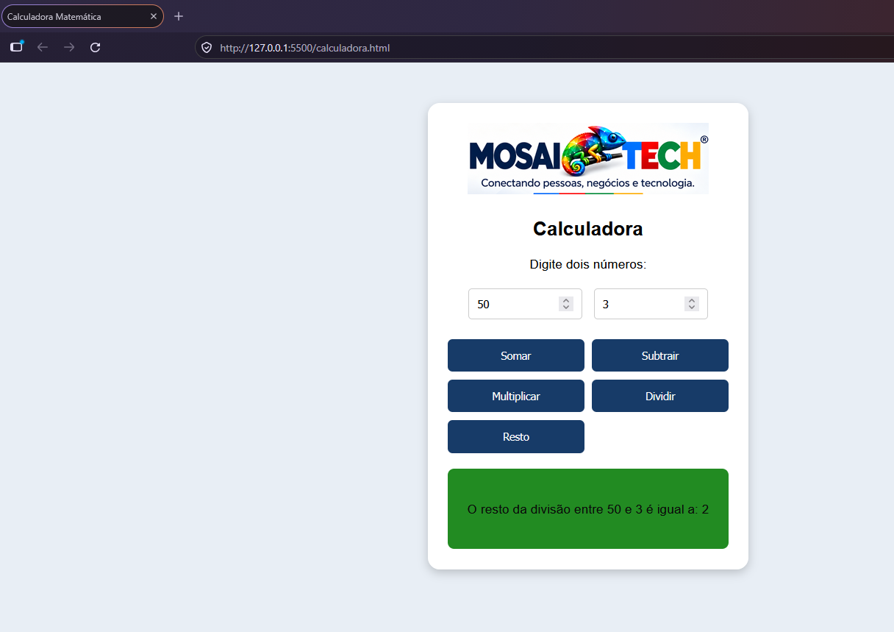

# 🦎 MOSAITECH \| Calculadora Matemática

<p align="center">

</p>


## 🖥️ Demonstração do Projeto – Calculadora MOSAITECH

Veja a interface da calculadora desenvolvida com HTML, CSS e JavaScript.

<p align="center">
  
</p>


## 📌 Sobre o projeto

A **MOSAITECH Calculadora Matemática** é uma aplicação web desenvolvida
com **HTML5, CSS3 e JavaScript**. O projeto foi criado para praticar os
fundamentos do desenvolvimento frontend, com atenção especial à lógica
de programação, aos eventos e à manipulação do **DOM (Document Object
Model)**.


A aplicação recebe dois valores numéricos, permite selecionar uma
operação matemática e apresenta o resultado diretamente na página.

Além do exercício técnico, este projeto faz parte da construção do
portfólio de soluções da **MOSAITECH**.

## 🎯 Objetivos

-   Praticar a estruturação de páginas com HTML5.
-   Aplicar estilos e organizar uma interface com CSS3.
-   Desenvolver funções em JavaScript.
-   Trabalhar com variáveis, conversão de tipos e operadores
    aritméticos.
-   Compreender como o JavaScript acessa elementos HTML pelo DOM.
-   Utilizar eventos para responder às ações do usuário.
-   Atualizar o conteúdo da página dinamicamente.
-   Exercitar a organização e publicação de projetos com Git e GitHub.


## ⚙️ Funcionalidades

A MOSAITECH Calculadora permite realizar cinco operações matemáticas utilizando dois números informados pelo usuário.

**➕ 1. Adição (Soma)**

Realiza a soma entre dois números.

Operador: `+`

**➖ 2. Subtração**

Calcula a diferença entre dois números.

Operador: `-`

**✖️ 3. Multiplicação**

Multiplica o primeiro número pelo segundo.

Operador: `*`

**➗ 4. Divisão**

Divide o primeiro número pelo segundo.

Operador: `/`

**% 5. Módulo (Resto da divisão)**

Retorna o resto de uma operação de divisão.

Operador: `%`

**Recursos disponíveis:**

- Entrada de dois valores numéricos.
- Botões individuais para cada operação.
- Execução das operações através de eventos JavaScript.
- Exibição dinâmica dos resultados na interface.
- Validação para evitar divisão por zero.

Também possui campos para entrada dos números, botões para executar cada
operação e uma área para exibir o resultado.

> **Validação:** nas operações de divisão e módulo, o segundo número não
> deve ser zero.

## 🛠️ Tecnologias e ferramentas


## 🛠️ Tecnologias utilizadas

### 🌐 HTML5
Responsável pela estrutura da aplicação.

- Criação dos campos de entrada numérica.
- Desenvolvimento dos botões de operações.
- Organização dos elementos da página.
- Estruturação da área de resultados.

### 🎨 CSS3
Responsável pela identidade visual e apresentação da calculadora.

- Definição de cores e planos de fundo.
- Espaçamentos e alinhamentos.
- Bordas arredondadas.
- Sombras e efeitos visuais.
- Organização dos botões com CSS Grid.
- Efeitos de interação com `:hover`.

### ⚡ JavaScript
Responsável pela lógica e funcionamento da aplicação.

- Declaração e manipulação de variáveis.
- Criação de funções.
- Operadores aritméticos.
- Conversão de valores com `Number()`.
- Template literals.
- Execução das cinco operações matemáticas.
- Tratamento de divisão por zero.

### 🌳 DOM (Document Object Model)
Responsável pela interação entre JavaScript e HTML.

- `getElementById()` — localização de elementos pelo ID.
- `querySelector()` — seleção de elementos por seletores CSS.
- `value` — captura dos valores digitados.
- `innerHTML` — atualização dinâmica dos resultados.
- `onclick` — execução das funções através dos cliques.

### 💻 Ferramentas de desenvolvimento

- Visual Studio Code (VS Code).
- Google Chrome / Mozilla Firefox.
- Live Server.
- Git.
- GitHub.

### Ferramentas

-   Visual Studio Code (VS Code)
-   Navegador web (Google Chrome, Firefox ou equivalente)
-   Git
-   GitHub

O projeto utiliza JavaScript puro (*Vanilla JavaScript*), sem frameworks
ou bibliotecas externas.

## 🧠 Conceitos de programação praticados

### 1. HTML5 --- Estrutura da página

Foram utilizados elementos HTML para estruturar a aplicação:

-   `html`: elemento raiz do documento.
-   `head`: metadados, título e estilos.
-   `body`: conteúdo visível da página.
-   `h1`: título ou identificação da aplicação.
-   `input`: campos numéricos e botões.
-   `div`: organização da área de resultado.
-   `script`: código JavaScript.

### 2. CSS3 --- Apresentação visual

O CSS foi utilizado para personalizar a interface e melhorar a
experiência de uso.

Algumas propriedades praticadas:

-   `background-color`: cor de fundo.
-   `margin`: espaçamento externo.
-   `padding`: espaçamento interno.
-   `border-radius`: arredondamento dos cantos.
-   `box-shadow`: sombra dos elementos.
-   `text-align`: alinhamento do texto.
-   `display: grid`: organização dos botões em colunas.
-   `cursor: pointer`: indicação visual de elemento clicável.
-   `:hover`: estilo aplicado quando o ponteiro passa sobre um botão.

### 3. JavaScript --- Lógica e operações

O JavaScript controla as operações e a interação com os elementos HTML.

**Variáveis e conversão de valores**

``` javascript
var n1 = Number(tn1.value)
var n2 = Number(tn2.value)
```

Os valores digitados em campos HTML são lidos e convertidos para o tipo
`Number`, permitindo realizar cálculos matemáticos.

**Funções**

``` javascript
function somar() {
    // Instruções para realizar a soma
}
```

Cada operação é organizada em uma função própria, chamada quando o
usuário seleciona o botão correspondente.

**Operadores aritméticos**

``` javascript
var soma = n1 + n2
var subtrai = n1 - n2
var multiplica = n1 * n2
var divisao = n1 / n2
var modulo = n1 % n2
```

**Template literals**

As crases permitem montar mensagens dinâmicas e inserir valores de
variáveis com `${...}`:

``` javascript
res.innerHTML = `A soma entre ${n1} e ${n2} é igual a ${soma}`
```

## 🌐 DOM --- Document Object Model

Um dos principais aprendizados deste projeto é a manipulação do **DOM**.

O DOM (*Document Object Model*) representa o documento HTML como uma
estrutura de objetos organizada em árvore. Por meio dele, o JavaScript
pode localizar elementos, ler valores e modificar o conteúdo da página.

### Métodos e propriedades utilizados

**`getElementById()`**

Localiza um elemento pelo valor do atributo `id`:

``` javascript
var tn1 = window.document.getElementById('txtn1')
```

**`querySelector()`**

Localiza um elemento usando um seletor CSS:

``` javascript
var tn2 = window.document.querySelector('input#txtn2')
```

**`value`**

Obtém o valor digitado pelo usuário em um campo de formulário:

``` javascript
var n1 = Number(tn1.value)
```

**`innerHTML`**

Altera o conteúdo HTML de um elemento:

``` javascript
res.innerHTML = `Resultado: <strong>${soma}</strong>`
```

### Eventos: `onclick`

O atributo `onclick` associa o clique do usuário à execução de uma
função JavaScript:

``` html
<input type="button" value="Somar" onclick="somar()">
```

### Fluxo de funcionamento

1.  O usuário informa dois números nos campos.
2.  O usuário clica em um dos botões de operação.
3.  O evento `onclick` chama a função correspondente.
4.  A função localiza os campos pelo DOM.
5.  Os valores são lidos e convertidos para números.
6.  O JavaScript executa a operação matemática.
7.  O resultado é apresentado na página por meio de `innerHTML`.

## 📂 Estrutura do projeto

``` text
mosaitech-calculadora/
│
├── index.html
├── README.md
│
├── image/
│   └── logo-mosaitech.png   # Logo exibida neste README
│
└── image/
    └── mosaitech-logo-header.png  # Logo usada no cabeçalho da aplicação
```

A estrutura acima representa uma organização possível para a versão com
HTML, CSS e JavaScript no mesmo arquivo. Caso os estilos e scripts sejam
separados futuramente, a estrutura poderá ser atualizada.

## 🚀 Como executar

**1. Clone o repositório**

``` bash
git clone URL_DO_SEU_REPOSITORIO
```

**2. Acesse a pasta**

``` bash
cd mosaitech-calculadora
```

**3. Abra no VS Code**

``` bash
code .
```

**4. Execute**

Abra o arquivo `calculadora.html` no navegador. Também é possível utilizar a
extensão Live Server do VS Code.

Não é necessário instalar dependências ou configurar um backend para
executar esta versão.

## 📚 Aprendizados

Com o desenvolvimento deste projeto, foram praticados:

-   Estruturação de documentos com HTML5.
-   Estilização de interfaces com CSS3.
-   Fundamentos da linguagem JavaScript.
-   Declaração e utilização de variáveis.
-   Criação e chamada de funções.
-   Operadores aritméticos.
-   Conversão de valores com `Number()`.
-   Template literals.
-   Seleção de elementos com `getElementById()` e `querySelector()`.
-   Leitura de campos com `value`.
-   Manipulação de conteúdo com `innerHTML`.
-   Eventos de clique com `onclick`.
-   Integração entre HTML, CSS, JavaScript e DOM.
-   Uso do VS Code, Git e GitHub.

## 🔭 Próximas melhorias

-   [ ] Separar HTML, CSS e JavaScript em arquivos próprios.
-   [ ] Melhorar a responsividade para celulares e tablets.
-   [ ] Adicionar botão para limpar os campos e o resultado.
-   [ ] Validar o preenchimento dos dois campos.
-   [ ] Criar histórico das operações realizadas.
-   [ ] Adicionar novas operações matemáticas.
-   [ ] Melhorar a acessibilidade dos campos e botões.
-   [ ] Criar testes para as funções matemáticas.
-   [ ] Publicar a aplicação com GitHub Pages.

## 🦎 Sobre a MOSAITECH

A **MOSAITECH** é uma marca de tecnologia que tem como propósito
desenvolver soluções digitais, conectar pessoas e negócios e transformar
ideias em projetos tecnológicos.

Sua identidade visual é representada por um camaleão geométrico
multicolorido, símbolo de adaptação, inovação, criatividade e
transformação.

**Slogan:**\
*Conectando pessoas, negócios e tecnologia.*

**Cores da identidade visual:**

-   🔵 Azul
-   🔴 Vermelho
-   🟢 Verde
-   🟡 Amarelo

A MOSAITECH acredita que conhecimento, tecnologia e inovação são
ferramentas fundamentais para construir novas possibilidades.

## 👨‍💻 Desenvolvimento

Projeto desenvolvido por **Lúcio Fábio Barbosa de Lima**, como parte dos
estudos e da prática de desenvolvimento frontend.

**Organização:** MOSAITECH\
**Stack:** HTML5 \| CSS3 \| JavaScript\
**Foco de aprendizagem:** DOM, eventos, funções e lógica de programação.

------------------------------------------------------------------------

⭐ Se este projeto foi útil para você, considere deixar uma estrela no
repositório.

**MOSAITECH --- Conectando pessoas, negócios e tecnologia.**


<p align="center">
  <strong>© 2026 MOSAITECH — Todos os direitos reservados.</strong>
  <br>
  Conectando pessoas, negócios e tecnologia.
</p>
